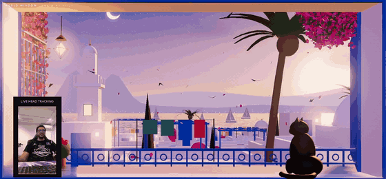

# World Window

A screen that behaves like a window. Move your head and the scene keeps real depth behind the glass, instead of sliding around like a picture.



*Recorded live: a phone used as a webcam (inset, bottom left) tracks the head, and the view follows.*

**Live demo:** https://alaabelghith.github.io/lab/world-window/ (move the mouse; the webcam is optional)

## How it works

- **Off-axis projection.** The screen is treated as a fixed rectangle in the 3D world. The camera sits at the viewer's eye and its frustum is skewed so the edges pass exactly through the screen's edges (`src/offaxis.js`). The scene stays locked to the bezel while near and far objects shift against each other, which is what a real window does.
- **Head position.** With the mouse: pointer = head, scroll = lean in or out. With a webcam: MediaPipe Face Landmarker gives the nose tip for left/right and up/down, and the distance between the outer eye corners gives a rough distance from the screen (`src/tracking.js`).
- **Scene.** *Sidi Bou Said, dusk* is built entirely in code: no textures or models are loaded. Window reveal, shutters, iron grille and a cat on the sill at arm's length; a terrace below; rooftops, domes and a minaret stepping down to the Gulf of Tunis; Boukornine and the lights of the far shore across the bay (`src/scenes/sidi.js`).

## Run it locally

```
python -m http.server 8080
```

then open http://localhost:8080 (on Windows, `serve.bat` does both). The first load needs internet: Three.js and the face model come from a CDN and are cached afterwards.

| Control | What it does |
|---|---|
| Mouse move | Moves the viewer's head |
| Scroll | Leans in or out |
| **Use webcam** | Switches to head tracking. A camera list appears; a DroidCam source is picked automatically when one is present |
| **Webcam / Phone, upright** | How the camera is mounted. Use "Phone, upright" for a phone standing in portrait as a webcam (DroidCam and similar) |
| **Fullscreen** | The illusion only reads properly full screen |

URL options: `?scene=glb` starts on the GLB scene, `?ui=0` hides the controls.

## Use your own scene

Drop a glTF binary at `assets/scene.glb` and pick "Beach (GLB)" in the scene list. From Blender: File > Export > glTF 2.0, format glTF Binary. The model is centred and scaled automatically; deep scenes work best, since depth is what the parallax shows. The file included here is a small beach diorama.

## Status

Working: off-axis projection, mouse control, both scenes.

Tested: head tracking with a phone used as a webcam, standing upright (DroidCam). That is the setup in the clip above.

Not finished:

- The mapping for an ordinary laptop or USB webcam is new and has not been tested yet, and the distance estimate is uncalibrated.
- No calibration yet for the real screen size or where the camera sits relative to it, so the perspective is plausible rather than exact.
- Next: a filmed demo on a large screen.

## Files

| Path | Contents |
|---|---|
| `index.html` | Page and controls |
| `src/main.js` | Renderer, input, main loop |
| `src/offaxis.js` | The off-axis projection |
| `src/tracking.js` | MediaPipe head tracking |
| `src/scenes/sidi.js` | The Sidi Bou Said scene |
| `src/scenes/glb.js` | Loader for a user-supplied GLB |

---
Built with AI coding assistance; concept and direction by Alaa Belghith, working as Anything Visual: [portfolio](https://alaabelghith.github.io).
Three.js is MIT licensed; MediaPipe is Apache 2.0.

Licence: MIT, see [LICENSE](LICENSE). Reuse it, credit Alaa Belghith.
